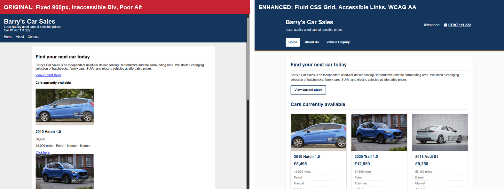
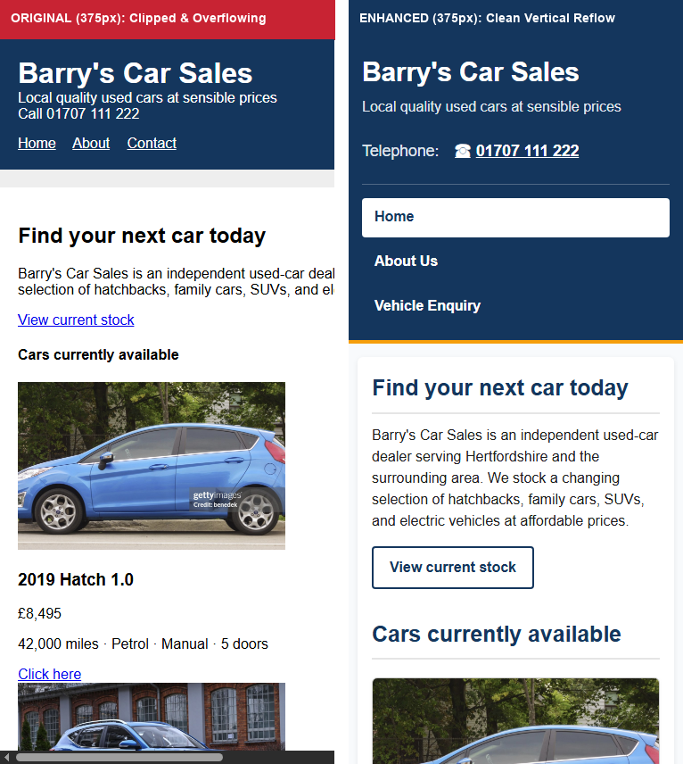
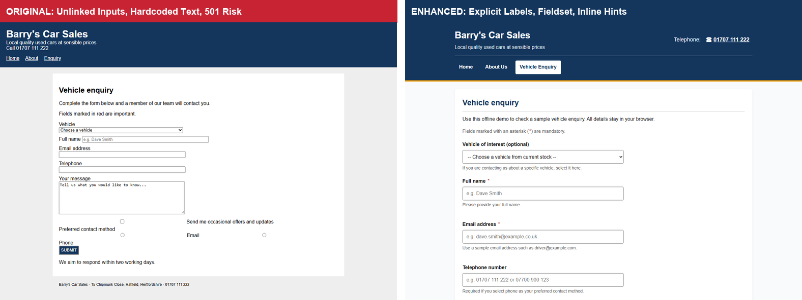
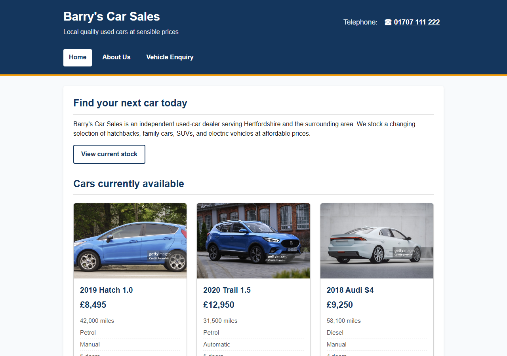
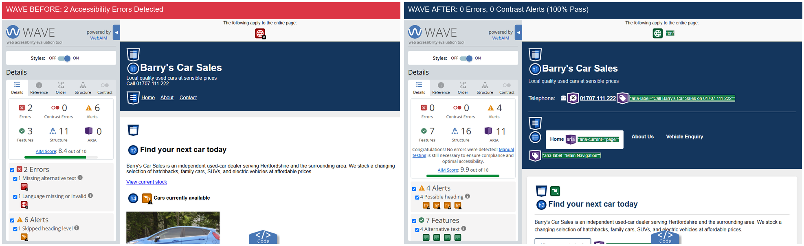

# Enhancing the Accessibility and Usability of a Web Application
## Coursework evaluation report: Barry's Car Sales

**Module Title:** Accessibility and Usability (5WCM2000 & 5WCM2001)  
**School:** Engineering and Computer Science, University of Hertfordshire  
**Tutor:** Dr. Barry Ip | **Internal Moderator:** Dr. Rishi Rutton  
**Student Name:** Hooriyah  
**Repository Link:** https://github.com/hooriyah2006/barrys-car-sales  
**Word Count Limit:** 2,500 words (excluding title details, tables, figures, code blocks, and references)

## 1. Introduction

Barry's Car Sales is a local Hatfield used-car website provided as the starter prototype for module 5WCM2000. The starter zip contained three static HTML pages (`index.html`, `about.html`, and `enquiry.html`), a 71-line stylesheet (`styles.css`), four car photographs, and a seven-line script (`script.js`). Narrowing the browser window or unplugging a mouse quickly exposes problems in those files.

Because `styles.css` hardcoded `width: 900px` on `main` and `footer` with no viewport `<meta>` tag in any `<head>`, mobile browsers have to scroll sideways to read car specs. Reading the markup turned up further barriers. On `index.html`, `<html>` had no `lang` attribute, `hatchback.jpg` lacked an `alt` attribute, and the 2020 Trail 1.5 button used `<div id="suv-enquiry">` with an `onclick` listener in `script.js` so `Tab` passed right over it. Over on `enquiry.html`, plain `<span>` elements sat next to Full name and the email updates checkbox with no matching `<label>` tags, and the contact radio controls lacked a `<fieldset>`. Before any edits, mobile Google Lighthouse Accessibility checks scored 66 on `index.html`, 96 on `about.html`, and 91 on `enquiry.html`.

All revised code stays in plain HTML5, CSS3, and ES6 JavaScript to keep the starter package running directly from a local folder without Bootstrap or jQuery. Each stage of work was committed to GitHub (`hooriyah2006/barrys-car-sales`) across nine incremental commits dated 6 November to 22 November 2026.

## 2. Accessibility evaluation and code improvements

### 2.1 Testing method
Under the module's ethics guidance, no external test volunteers took part in this study. I tested both the starter pages and my edited files on my own machine using Google Chrome and Microsoft Edge.

Google Lighthouse v12.8.2 (running mobile device emulation) and the WebAIM WAVE v3.3.1.0 Chrome extension supplied baseline error counts and scores. Lazar, Goldstein and Taylor (2015) estimate that automated scanners catch only around 30 to 40 percent of real web barriers, because tools cannot judge reading context or interactive keyboard flow. Manual testing therefore took just as much weight during my audit:

* Disconnecting the mouse to walk every page top to bottom with `Tab`, `Shift+Tab`, `Enter`, and `Space`, checking that custom buttons, table wrappers, and links match visual order.
* Dragging DevTools viewports down to 320px wide and pushing browser text zoom to 400% to inspect reflow under WCAG 2.1 Level AA criterion 1.4.10.
* Inspecting the Chrome DevTools Accessibility tree during form errors so computed names, table roles, `aria-required`, `aria-invalid`, `role="alert"`, and `role="status"` states could be checked directly.

### 2.2 Baseline problems in the starter site
Running WAVE and Lighthouse against each starter page showed a different pattern of failures on each HTML document.

Home (`index.html`) scored 66 for Accessibility and 89 for Best Practices in mobile Lighthouse (`html-has-lang`, `image-alt`, and `heading-order` failed, plus missing `viewport`, small mobile typography, and a console 404 for `/favicon.ico`). WAVE flagged 2 errors (`1 Missing alternative text` on `hatchback.jpg`, `1 Language missing or invalid`) and 6 alerts. Headings dropped from `<h2>` straight down to `<h4>` with no `<h3>`. Image quality varied too: `hatchback.jpg` had no `alt` attribute, `saloon.jpg` used `alt="car"`, and `suv.jpg` read `"A blue SUV for sale"` without the model name. Even worse, `script.js` attached an `onclick` listener directly onto a non-interactive container:

```html
<!-- Original starter SUV trigger -->
<div id="suv-enquiry">Ask about this car</div>
```

A bare `<div>` carries no semantic role and stays outside the keyboard `Tab` sequence, so keyboard users could not open any 2020 Trail 1.5 enquiry. Two other stock links read `"Click here"` and `"More"`, which fails WCAG 2.4.4 Link Purpose once screen reader users pull up a list of page links out of context.

On `about.html`, `lang="en"` was already present in the starter markup, so Lighthouse scored Accessibility higher at 96 (`heading-order` and `td-has-header` failed) alongside 89 for Best Practices. WAVE recorded 0 errors and 3 alerts (a skipped heading from `<h2>` to `<h4>`, suspicious `"Click here"` link text, and a layout table). Main navigation also flipped link order to `Contact / Home / About Us`, `"What we do"` used `<div><strong>` not `<h3>`, and staff records sat inside plain `<td>` cells without column/row `<th>` headers or a `<caption>`. Screen readers moving across row cells could not connect `"Customer Adviser"` or `"20 years' motor trade experience"` back to Barry Doe, Chris Doe, or Mac Doe.

Enquiry controls on `enquiry.html` scored 91 in Lighthouse (`label` audit failures across three control groups) and 89 for Best Practices. WAVE logged 4 errors (`4 Missing form label`) and 2 alerts (`1 Orphaned form label`, `1 Missing fieldset`). Full name and the marketing checkbox used unlinked `<span>` elements, the Email/Phone radio buttons had no `<fieldset>` or `<legend>`, `autocomplete` tokens were missing, and prompt instructions inside `<textarea>` were inserted as an editable field value with no `placeholder` attribute. Page notice copy claimed `"Fields marked in red are important"`, yet `styles.css` defined zero red CSS rules (failing WCAG 1.4.1 Use of Color). None of the starter pages included a skip link above navigation.

### 2.3 Implemented fixes and styling decisions
I fixed HTML structure first across separate commits, then rebuilt CSS layout rules and validation scripts cleanly.

All three pages now carry `<html lang="en">`, `<meta name="viewport" content="width=device-width, initial-scale=1.0">`, and a hidden skip link (`<a href="#main-content" class="skip-link">Skip to main content</a>`) that moves into view on keyboard focus. On `index.html`, headings follow sequential nesting (`<h1>` header title -> `<h2>` page sections -> `<h3>` vehicle cards inside `<article class="car-card">`), and every vehicle image `alt` names colour, year, model, and body style (for instance, `"Blue 2019 Hatch 1.0 five-door hatchback"` and `"Silver 2018 Audi S4 executive four-door saloon"`). The inaccessible SUV `<div>` was replaced by an explicit anchor button carrying the vehicle title and model query string:

```html
<a href="enquiry.html?car=2020+Trail+1.5" class="btn btn-primary">Enquire about the 2020 Trail 1.5</a>
```

On `about.html`, I standardised navigation order to `Home | About Us | Vehicle Enquiry` with `aria-current="page"`, promoted `"What we do"` to `<h3>`, and marked up the showroom schedule as a semantic `<dl>` definition list. For the staff directory, adding `<caption>`, `<thead>`, `<th scope="col">`, and `<th scope="row">` establishes clear cell headers in the accessibility tree. Putting that table inside `<div class="table-responsive" tabindex="0" role="region" aria-labelledby="team-heading">` lets keyboard and phone users scroll columns horizontally inside a focusable region without widening the document body at 320px.

Controls on `enquiry.html` now pair every input with an explicit `<label for="...">`, standard `autocomplete` tokens (`name`, `email`, `tel`), visible hints linked via `aria-describedby`, and a `*` marker paired with `.sr-only` text (`(required)`). Contact preference options live inside `<fieldset>` and `<legend>`. Checkboxes, radios, and buttons use 24px controls and `--touch-target: 44px` minimum hit targets. Choosing `Phone` executes `updatePhoneRequirement()` in `script.js` to set `phoneField.required = true`, switch `aria-required` to `"true"`, display the `*` badge, and update `#phone-hint` copy immediately.

For layout and colour in `styles.css`, starter `body { background: #eeeeee; }` and fixed `900px` boxes gave way to a light slate page background (`--bg-page: #f8fafc`), white cards (`--bg-surface: #ffffff`), `calc(100% - 30px)` outer limits, and CSS Grid (`repeat(auto-fill, minmax(260px, 1fr))`) for the car cards (Figures 1 and 2). During testing at 320px and 375px width, `.brand-group { flex: 1 1 300px; }` unexpectedly stretched header height vertically once `.header-container` switched to `flex-direction: column` under 600px. Adding `.brand-group { flex: none; width: 100%; }` inside `@media (max-width: 600px)` removed that gap completely. I also added a high-contrast focus ring (`3px solid #172e47` plus `0 0 0 3px #fff`) on `:focus-visible` and a `@media (prefers-reduced-motion: reduce)` rule disabling CSS transitions. Checking relative luminance ratios confirmed WCAG AA margins across the UI palette: `#14365d` navy on `#ffffff` reaches 12.24:1, `#1c1c1c` body copy on `#f8fafc` reaches 16.29:1, `#555555` hint copy reaches 7.46:1, `#b71c1c` validation errors on `#ffebee` reach 5.75:1, and `#f59e0b` amber (`--accent-color`) reaches 5.70:1 against `#14365d` when restricted to the 4px bottom header border (kept off white surfaces where it yields only 2.15:1).





Each technical fix maps back to WCAG 2.1 Level A or AA requirements in Table 1.

| WCAG 2.1 Criterion | Starter Defect | Technical Fix Applied | Outcome |
| :--- | :--- | :--- | :--- |
| **1.1.1 Non-text Content (A)** | Missing `alt` on `hatchback.jpg`; generic `"car"` on saloon. | Descriptive `alt` attributes stating colour, model, and body type. | 0 WAVE alt errors across pages. |
| **1.3.1 Info & Relationships (A)** | Skipped `h2`->`h4`; unlabelled table/form elements; bold `div` headings. | Sequential headings, `<th>` scopes with `<caption>`, `<label for>`, `<fieldset>`. | Valid hierarchy in Accessibility tree. |
| **1.4.1 Use of Color (A)** | Red field text rule claimed with no red field styles in CSS. | Combined red text (`#b71c1c`), `*` symbols, and `.sr-only` required text. | Clear without visual colour cues. |
| **1.4.3 Contrast Minimum (AA)** | Unverified hierarchy tones (`footer` text, muted labels, accents). | Verified 12.24:1 navy, 16.29:1 text, 7.46:1 muted, 5.70:1 header stripe. | 0 WAVE contrast errors on all pages. |
| **1.4.10 Reflow (AA)** | Fixed `900px` `main`/`footer` forced horizontal scrollbars. | Viewport `<meta>`, CSS Grid cards, and mobile `.brand-group` fix down to 320px. | Zero horizontal scroll at 320px / 400% zoom. |
| **2.1.1 Keyboard (A)** | SUV `#suv-enquiry` used unfocusable `<div>` with JS `onclick`. | Replaced `<div>` with standard `<a href="enquiry.html?car=...">`. | Full Tab/Enter keyboard activation. |
| **2.4.1 Bypass Blocks (A)** | Users had to tab through site navigation on every load. | Added off-screen `.skip-link` revealed on focus pointing to `#main-content`. | Immediate jump past header links. |
| **2.4.4 Link Purpose (A)** | Generic `"Click here"` and `"More"` anchors lacked vehicle context. | Explicit vehicle link labels such as `"Enquire about the 2020 Trail 1.5"`. | Links understandable out of context. |
| **2.4.7 Focus Visible (AA)** | Subtle default focus ring disappeared over dark header or shadows. | Two-tone `:focus-visible` outline (`#172e47` and white ring) plus skip focus. | Clear focus ring on every element. |
| **3.1.1 Language of Page (A)** | `index.html` left `lang` off `<html>`. | Declared `<html lang="en">` on every page. | 0 WAVE language errors. |
| **3.3.1 / 3.3.2 Errors & Labels (A)** | Silent submit failures, unlinked spans, literal textarea default text. | Client-side checks, `#error-summary` (`role="alert"`), hints, `placeholder`. | Descriptive inline validation feedback. |
| **4.1.2 Name, Role, Value (A)** | Missing live `aria-invalid` and `aria-required` attributes. | Updated ARIA attributes and hint copy dynamically in `script.js`. | Confirmed in DevTools tree inspection. |

## 3. Usability evaluation against Nielsen's heuristics

Automated scanners catch markup violations, not broken workflows. Reviewing the starter site against Jakob Nielsen's ten usability heuristics (Nielsen, 1994) picked up several dead ends for real visitors. Clicking `SUBMIT` on `enquiry.html` fired a standard POST to `#`, which triggers HTTP 501 errors locally on static servers while showing zero validation messages. Selecting a car on `index.html` did not carry the model across to `enquiry.html`, forcing users to remember names from memory, and navigation links moved positions (`Contact` first on `about.html`, last on `index.html`).

Table 2 matches each heuristic problem from the starter pages to the code built to fix it.

| Nielsen Heuristic | Original Issue | Enhancement Implemented |
| :--- | :--- | :--- |
| **H1: Visibility of System Status** | Pressing `SUBMIT` showed no feedback and triggered broken static POST errors. | `event.preventDefault()` handler shows `#error-summary` (`role="alert"`) or `#submission-success` (`role="status"`). |
| **H2: Match System & Real World** | Generic `"More"` / `"Click here"` anchors and abrupt `"SUBMIT"` label. | Everyday car copy (`"Enquire about the 2018 Audi S4"`, `"Check enquiry"`), UK pricing (`£8,495`), and `tel:` links. |
| **H3: User Control & Freedom** | No skip link, no form reset path, static failures without JS. | Added `.skip-link`, `"Clear Form"`, `"Send another enquiry"` reset, and `<noscript>` showroom phone notice. |
| **H4: Consistency & Standards** | `about.html` swapped navigation links with no active-tab state. | Fixed sequence (`Home`, `About Us`, `Vehicle Enquiry`), active CSS style, and `aria-current="page"`. |
| **H5: Error Prevention** | `<textarea>` held default body value; no `autocomplete` or formatting clues. | Switched to `placeholder`, added `autocomplete` tokens, inline examples, and a 10-character message minimum. |
| **H6: Recognition Rather than Recall** | Opening `enquiry.html` from a vehicle card left the dropdown unselected. | `initQueryParamAutoSelection()` parses `?car=` via `URLSearchParams` to pick the matching vehicle automatically. |
| **H7: Flexibility & Efficiency** | Small 13px native checkboxes/radios on touchscreens; plain text phone numbers. | 44px touch targets for interactive controls; `tel:01707111222` links in header, footer, and alerts. |
| **H8: Aesthetic & Minimalist Design** | Unstyled table lines, cramped `<br>` hours blocks, narrow form alignment. | Soft `#f8fafc` backdrop with crisp `#ffffff` cards, `1.5` line height, and structured `<dl>` opening hours. |
| **H9: Error Recovery** | Users received no summary or jump links pointing to broken inputs. | `#error-list` anchor items focus fields on click; `clearSpecificFieldError(fieldOrId)` clears edited fields individually. |
| **H10: Help & Documentation** | Absent phone fallback, vague required rule, unclear demo behaviour. | Persistent showroom address/hours, clear local-check notice, `<noscript>` help block, and field-level hints. |

Two JavaScript functions carry most of that usability logic. In `initQueryParamAutoSelection()`, matching URL parameters against dropdown options uses both exact equality and case-insensitive substring matching so `?car=2020+Trail+1.5` selects the SUV automatically even if label text varies. Live testing hit an early edge case: checking `query.indexOf(val) !== -1` matched the blank placeholder `<option value="">` at index `0` because every string contains an empty substring at position `0`. Adding `if (!val) continue;` fixed dropdown selection immediately:

```javascript
function initQueryParamAutoSelection() {
    var carSelect = document.getElementById("car");
    if (!carSelect) return;
    var selectedCar = new URLSearchParams(window.location.search).get("car");
    if (!selectedCar) return;

    var query = selectedCar.toLowerCase().trim();
    for (var i = 0; i < carSelect.options.length; i++) {
        var opt = carSelect.options[i];
        var val = opt.value.toLowerCase().trim();
        if (!val) continue;
        if (val === query || val.indexOf(query) !== -1 || query.indexOf(val) !== -1) {
            carSelect.selectedIndex = i;
            opt.selected = true;
            break;
        }
    }
}
```

Inside `initAccessibleFormValidation()`, submitting checks full name presence, email format via `emailRegex`, phone length (7 to 15 digits if provided or if `Phone` contact is picked), and `msgVal.length < 10` (matching the hint `(minimum 10 characters)`). When checks fail, keyboard focus shifts to `#error-summary`, and each list link calls `err.field.focus()` on activation. Editing any field runs `clearSpecificFieldError(fieldOrId)`, accepting either a DOM node or string ID, so resolved warnings vanish immediately without erasing unresolved errors elsewhere on the form (Norman, 2013). Once every field passes, `form.style.display = "none"` hides the form and shifts focus onto `#submission-success` with a personalised confirmation and `#btn-reset-form` reset button (`"Send another enquiry"`, Figure 3).



## 4. Quantitative audit results

### 4.1 Google Lighthouse mobile audits
Six saved Lighthouse v12.8.2 JSON files (`evidence/before-*.json` and `evidence/enhanced-*.json`) document baseline and post-fix mobile scores. Those saved Lighthouse configs audited Accessibility and Best Practices only (SEO categories were omitted), as shown in Table 3.

| Page | Lighthouse Category | Before Score | After Score | Change |
| :--- | :--- | :--- | :--- | :--- |
| **Home (`index.html`)** | Accessibility | 66 / 100 | **100 / 100** | +34 |
| | Best Practices | 89 / 100 | **96 / 100** | +7 |
| **About Us (`about.html`)** | Accessibility | 96 / 100 | **100 / 100** | +4 |
| | Best Practices | 89 / 100 | **96 / 100** | +7 |
| **Enquiry (`enquiry.html`)** | Accessibility | 91 / 100 | **100 / 100** | +9 |
| | Best Practices | 89 / 100 | **96 / 100** | +7 |

Accessibility moved up to 100/100 on all three HTML pages, led by the +34 jump on `index.html`. Adding `<meta name="viewport">` and larger form controls pushed Best Practices from 89 to 96; the final -4 deduction comes solely from a console HTTP 404 for `/favicon.ico` when opening the folder locally without an icon asset. Figure 4 shows the finished desktop home grid.



### 4.2 WebAIM WAVE checks and accepted alerts
WAVE dropped total Errors to 0 across every page, while Contrast Errors stayed 0 before and after because the starter navy header (`#14365d`) and white cards already exceeded minimum contrast thresholds (Table 4 and Figure 5).

| Page | Starter Errors | Starter Contrast Errors | Starter Alerts | Enhanced Errors | Enhanced Contrast Errors | Enhanced Alerts |
| :--- | :--- | :--- | :--- | :--- | :--- | :--- |
| **Home (`index.html`)** | 2 | 0 | 6 | **0** | **0** | 4 |
| **About Us (`about.html`)** | 0 | 0 | 3 | **0** | **0** | 1 |
| **Enquiry (`enquiry.html`)** | 4 | 0 | 2 | **0** | **0** | 1 |

Six WAVE Alerts remain on the enhanced pages and were deliberately retained after manual inspection, matching coursework requirements to explain accepted tool warnings:

* **Home (`4 Possible heading`):** WAVE warns when bold `.car-price` paragraphs (`1.35rem`) sit visually near card titles. Keeping vehicle prices in `<p>` elements below `<h3>` titles avoids polluting the document heading outline with currency figures.
* **About Us (`1 Redundant link`):** Listing `tel:01707111222` in the header, footer, and inline showroom note repeats one destination URL on purpose so callers can trigger dialling from any point without scrolling back up.
* **Enquiry (`1 Noscript element`):** Retaining `<noscript>` warns non-JavaScript browsers away from a static form that cannot run `event.preventDefault()` validation or post to an API, pointing them to the showroom phone line instead.



## 5. Commercial context, legal duties, and trade-offs

Barry's Car Sales markets vehicles between £8,495 and £14,995 to Hatfield motorists, where losing one online enquiry wipes out significant retail revenue. Scope (2023) puts the annual spending power of roughly 16 million disabled people in the UK (the "Purple Pound") at £274 billion. Click-Away Pound (2019) survey data reports over 73 percent of disabled consumers walk away from hard-to-use websites in favour of accessible competitors. Meaningful HTML headings and clear vehicle names also help local search indexing for used car queries without extra marketing spend (Horton and Quesenbery, 2014).

Accessibility is also a statutory obligation in the UK. Under the Equality Act 2010, commercial websites count as public services whose operators must make reasonable adjustments so disabled buyers do not face substantial barriers (Great Britain, 2010). Across Europe, the European Accessibility Act (Directive 2019/882) connects e-commerce compliance to EN 301 549 and WCAG 2.1 Level AA (European Parliament and Council of the European Union, 2019; W3C, 2018). Professionally, the British Computer Society (BCS, 2022) Code of Conduct obliges computing graduates to protect public access and avoid discriminatory exclusions in software systems.

Practical trade-offs also shaped the code. Writing vanilla JavaScript and plain CSS keeps total file size minimal with zero build tools, though I had to build ARIA error summaries and conditional phone rules manually in `script.js` where a CSS/UI library might include prebuilt components. Keeping submission strictly client-side allows the project to run offline from a folder with zero server cost, though real customer enquiries cannot be stored in a database or emailed to staff yet. Putting the `about.html` employee directory inside an `overflow-x: auto` focusable container preserves multi-column role and experience scanning down to 320px width, even though small screens have to pan the table slightly.

## 6. Version control reflection, limitations, and future improvements

Tracking every layer across nine chronological Git commits (`hooriyah2006/barrys-car-sales`) made refactoring much safer than editing all files at once. Separating starter baseline files (6 Nov), `index.html` cards (8 Nov), `about.html` table structure (10 Nov), `enquiry.html` controls (13 Nov), CSS Grid styles (15 Nov), JS validation (17 Nov), documentation updates (19 Nov), audit JSONs and captures (20 Nov), and final mobile/JS bug fixes (22 Nov) made `git diff` inspections quick whenever a layout tweak risked breaking selectors. That commit timeline also helped isolate regressions fast when manual testing exposed the empty `value=""` dropdown bug and the mobile `.brand-group` header height bug.

Several real limits remain in the finished prototype. Scoring 100/100 in Lighthouse Accessibility and 0 WAVE errors with keyboard checks verifies baseline code structure only; it does not test how disabled drivers using JAWS, NVDA, VoiceOver, or switch hardware actually experience the pages, since participant recruitment sat outside module ethics clearance. Client-side JS validation handles formatting rules in browser memory without spam filtering or backend API storage. Car listings also stay hardcoded to four static cars with no stock search or interior galleries.

Before any live showroom deployment, Barry's Car Sales should wire `enquiry.html` to a validated server endpoint with rate limiting and email alerts, add an `aria-live="polite"` filter bar for price and fuel type, supply a `/favicon.ico` icon to bring Lighthouse Best Practices up to 100/100, and commission moderated testing with disabled motorists under formal ethics approval.

## 7. References

* British Computer Society (BCS), 2022. *The BCS Code of Conduct for IT Professionals*. Swindon: BCS.
* Click-Away Pound, 2019. *The 2019 Click-Away Pound Report: Results from the survey examining the online shopping experience of people with disabilities*. Available at: <https://www.clickawaypound.com/> [Accessed 20 November 2026].
* European Parliament and Council of the European Union, 2019. *Directive (EU) 2019/882 of the European Parliament and of the Council on the accessibility requirements for products and services (European Accessibility Act)*. Official Journal of the European Union, L 151, pp. 70-115.
* Great Britain, 2010. *Equality Act 2010*. London: The Stationery Office.
* Horton, S. and Quesenbery, W., 2014. *A Web for Everyone: Designing Accessible User Experiences*. Brooklyn: Rosenfeld Media.
* Lazar, J., Goldstein, D.F. and Taylor, A., 2015. *Ensuring Digital Accessibility Through Process and Policy*. Cambridge: Morgan Kaufmann.
* Nielsen, J., 1994. *Usability Inspection Methods*. New York: John Wiley & Sons.
* Norman, D.A., 2013. *The Design of Everyday Things: Revised and Expanded Edition*. New York: Basic Books.
* Scope, 2023. *Disability facts and figures: The spending power of disabled people (The Purple Pound)*. London: Scope.
* W3C (World Wide Web Consortium), 2018. *Web Content Accessibility Guidelines (WCAG) 2.1*. W3C Recommendation 05 June 2018. Available at: <https://www.w3.org/TR/WCAG21/> [Accessed 18 November 2026].
